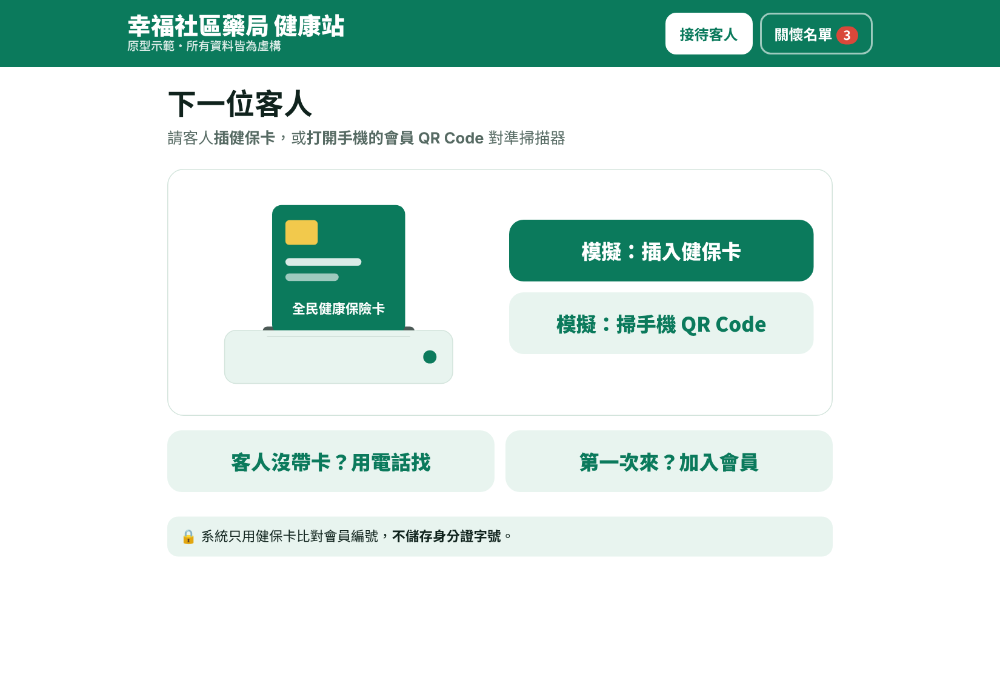
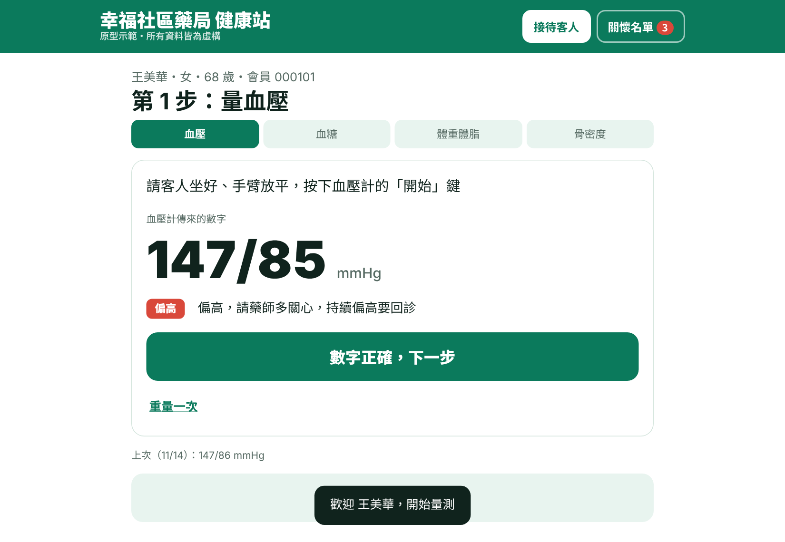
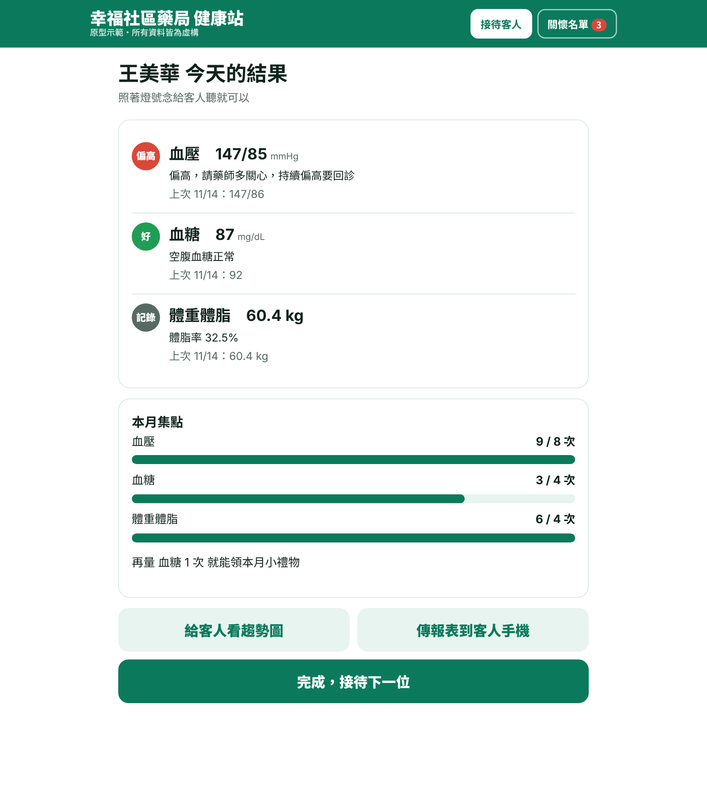
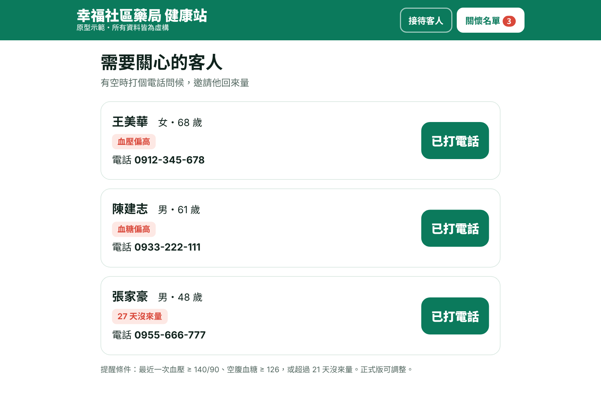
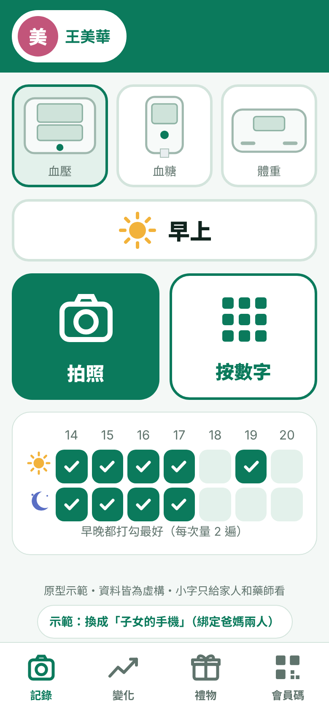
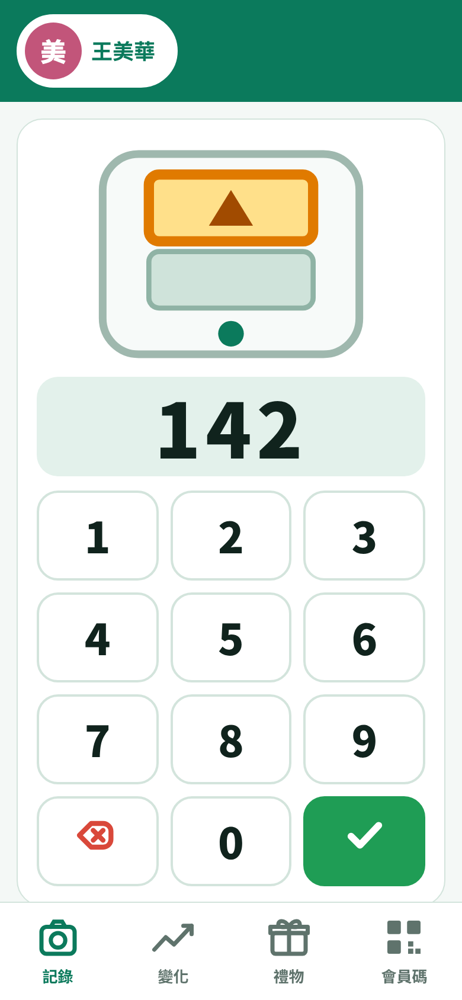
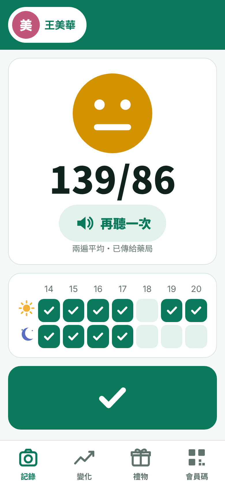
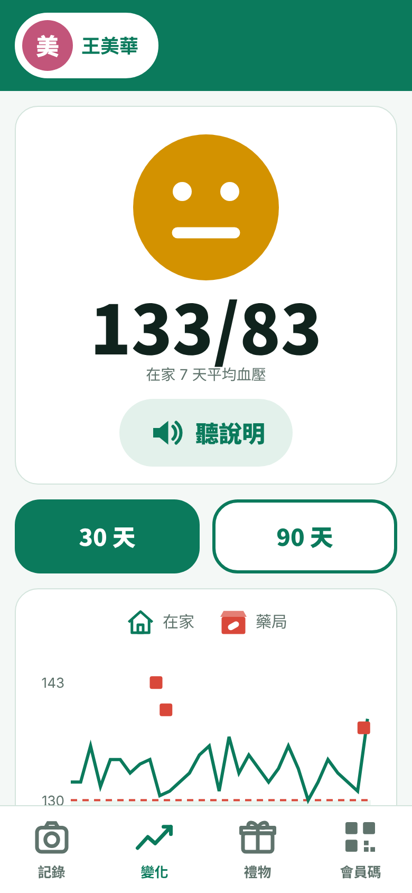

# smart-ltc

社區藥局健康追蹤系統：讓社區鄉親在藥局和家裡長期記錄血壓、血糖、體重體脂、骨密度，藥師用圖表解說、主動關懷，並以「完成量測」集點換小禮物，養成回店習慣。

> 目前狀態：**設計與原型階段**，尚未開始正式開發。

## 設計重點

- **藥師是電腦小白**：櫃檯只有一條引導式流程，按最大的按鈕往下走。
- **鄉親多不識字、看得懂數字**：客人端只用圖片、顏色、表情、大數字和語音。
- **店內量測拿來集點，居家量測拿來追蹤**（血壓照 722 原則）。
- **不儲存身分證字號**；姓名電話加密；所有存取留稽核紀錄。
- 客人端做在 **LINE** 裡，不用另外裝 App；支援家屬代填。
- **語音健康日誌**：不舒服時在 LINE 講一段話，自動轉文字、整理成看診用的 SOAP「S」。
- 內部用 SQLite，對外交換輸出 **FHIR（衛福部 TW Core IG）**。

## 畫面預覽

> 以下為原型截圖，資料皆為虛構。

### 藥局櫃檯版（藥師操作）

| 報到：插健保卡或掃會員碼 | 逐步量測：儀器數值自動帶入 |
|---|---|
|  |  |
| **今天的結果：燈號＋白話說明＋本月集點** | **關懷名單：偏高或久未回訪的客人** |
|  |  |

### 客人手機版（不用識字）

| 記錄：選儀器、早晚、拍照或按數字 | 按數字：儀器圖上標出要抄的格子 | 結果：表情＋大數字＋語音 | 變化：在家與藥局分開顯示 |
|---|---|---|---|
|  |  |  |  |

截圖由 `prototypes/` 的原型自動產生；原型更新後執行 `python scripts/screenshots.py` 重新截圖。

## 文件

| 檔案 | 內容 |
|---|---|
| [docs/decisions.md](docs/decisions.md) | 已確定的業務與設計決定、待確認事項 |
| [docs/architecture.md](docs/architecture.md) | 系統架構、技術選型、業務規則、API、FHIR 對應、開發階段 |
| [db/](db/) | SQLite 資料表（001 初始、002 健康日誌與居家安全） |

## 原型

單一 HTML 檔，用瀏覽器直接打開即可（資料皆為虛構，不會儲存）。

| 檔案 | 內容 |
|---|---|
| [prototypes/pharmacy-counter.html](prototypes/pharmacy-counter.html) | 藥局櫃檯版：報到 → 逐步量測 → 燈號結果 → 集點 → 傳報表；關懷名單 |
| [prototypes/patient-phone.html](prototypes/patient-phone.html) | 客人手機版（不用識字）：拍照或按數字記錄、表情與語音、一週早晚格、禮物、會員碼；家屬帳號切換 |

## 開發階段

1. **基本版**（不需硬體）：會員、店內量測、燈號、集點、趨勢圖、關懷名單、部署與備份
2. **LINE 與居家回報**：綁定、客人端 LIFF、AI 讀照片、台語語音、紙本卡匯入、家屬
3. **硬體**：健保卡讀卡小幫手、藍牙血壓計／體脂計／血糖機
4. **FHIR 輸出**：有交換對象時實作，通過 TW Core IG 驗證

## 技術

TypeScript ・ Node.js 22 + Hono ・ SQLite + better-sqlite3 ・ Litestream ・ React + Vite (PWA) ・ LINE Messaging API + LIFF ・ Google Cloud（台灣機房）
